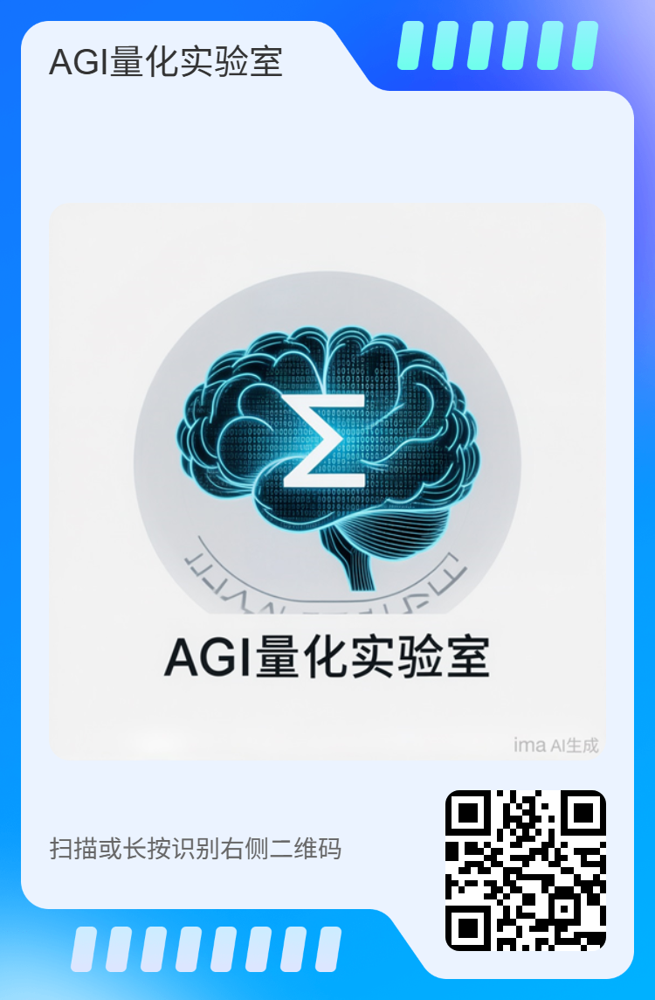
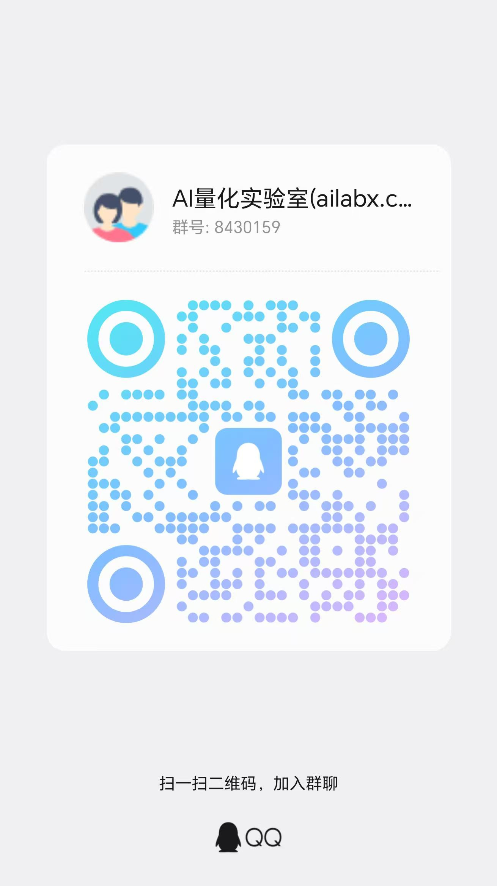

# AgiLab（Agi 实验室）

将前沿 AI 技术落地为真实生产力：量化投资・多智能体・科研自动化

Official Website: http://www.ailabx.com/

AgiLab 是一个面向开发者的 AI 落地实验室。我们不追概念、不炒名词，只做一件事：把前沿 AI 技术变成能跑、能赚钱、能提效的真实系统。

## 当前聚焦三大方向：

### 量化投资
用工程化、系统化的方式做资产配置、因子挖掘与策略实盘，让代码替你管理资产。

### 多智能体落地
从 API 到 Harness，构建可上生产的 Agent 系统，解决真实业务问题。

### 科研自动化
用 AI 重构文献调研、实验设计、论文写作与验证流程，加速科研产出。

#### 专栏体系
本仓库同步维护所有专栏的配套代码，边看边敲，随专栏持续更新。

进行中 **《程序员的量化实战课》**

面向有编程基础的开发者，从零到一写出第一个可以实战的量化策略。
不铺冗长理论，按程序员的习惯推进：先跑通 Hello World，再逐步深入。全程坚持工程化标准 —— 逻辑可描述、规则可编码、结果可回测、风险可管控。

#### 配套内容：

- 专栏文章
- 视频课程
- 专属微信群答疑
- 策略代码下载

订阅下方小鹅通店铺，获取完整专栏、**策略代码**与配套资源：

QQ群（请备注来自：github）

